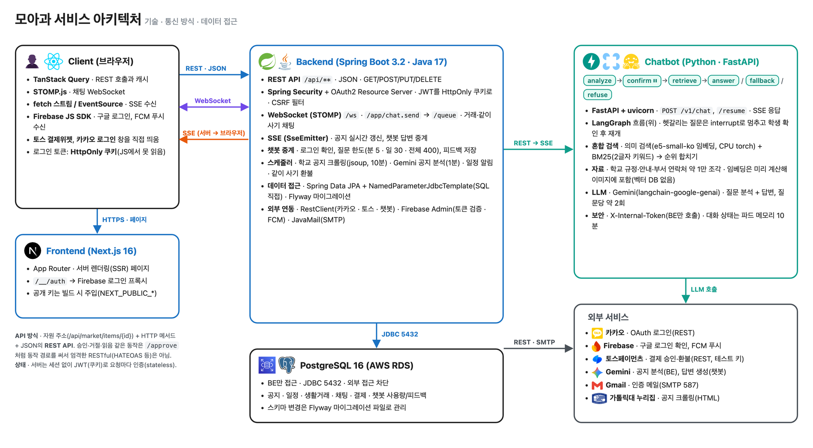

# 모아과 백엔드

가톨릭대학교 학내 공지, 일정, 생활 거래, 채팅, 알림을 제공하는 Spring Boot API 서버. 학교와 학과 홈페이지 공지를 수집해 Gemini로 날짜와 분류를 추출하고, 학교 안내 챗봇 요청을 별도 챗봇 서비스로 중계함.

🔗 서비스: https://moagwa.zruor.cc

## 서비스 아키텍처



| 통신 | 용도 |
| --- | --- |
| REST + JSON (`/api/**`) | 화면 조회와 변경. 로그인 토큰은 HttpOnly 쿠키, 변경 요청은 `X-Requested-With` 헤더로 CSRF 방어 |
| SSE (`/api/stream`) | 공지 등록, 수정, 삭제를 학생 화면에 즉시 반영 |
| SSE (`/api/me/chatbot`) | 챗봇 서비스 답변을 글자 단위로 중계 |
| STOMP over WebSocket (`/ws`) | 거래, 같이 사기 채팅과 읽음 표시 |
| FCM | 새 공지, 중요 공지, 거래, 채팅, 리마인더 웹 푸시 |

## 주요 기능

| 영역 | 내용 |
| --- | --- |
| 인증 | Google(Firebase ID Token), Kakao OAuth 학생 로그인, 관리자 아이디 로그인. 자체 JWT를 HttpOnly 쿠키로 발급하고 리프레시 토큰은 한 번 쓰면 교체 |
| 공지 | 관리자 공지(블록 본문, 예약 게시, 마감, 복제, 알림 다시 보내기)와 크롤링 공지를 하나의 피드로 조회. 검색 범위, 정렬, 맞춤 피드 |
| 공지 수집 | 학교, 학과 홈페이지 크롤링(10분), 썸네일과 첨부파일 수집, Gemini로 마감일, 행사일, 카테고리, 키워드 추출, 학사일정 수집 |
| 일정, 알림 | 개인 일정, 저장 공지와 일정 리마인더, 알림함과 수신 설정, 날짜 교정 요청과 운영자 검토 |
| 생활 거래 | 재학생 이메일 인증, 중고거래, 같이 사기(토스페이먼츠 결제, 취소와 목표 미달 시 자동 환불), 채팅 |
| 단체, 운영 | 단체 관리자 신청과 운영자 승인, 비밀번호 설정 메일, 단체 정보 관리 |
| 챗봇 중계 | 로그인 확인, 질문 한도(학생별 1분 5회, 하루 30회, 전체 하루 400회), 확인 대기 대화 소유자 확인, 피드백 저장, 최근 공지를 챗봇 검색 색인에 동기화 |
| 개인정보 | 약관 동의 기록, 회원 탈퇴, 보관 기간이 지난 알림과 개인정보 파기 |

### 주기 작업

| 작업 | 주기 | 클래스 |
| --- | --- | --- |
| 홈페이지 공지 크롤링 | 10분 | `crawler/CrawlScheduler` |
| Gemini 공지 정보 추출 | 1분 | `crawler/NoticeExtractionJob` |
| 예약 공지 게시 | 30초 | `admin/PublishScheduler` |
| 리마인더 발송 | 1분 | `reminder/ReminderScheduler` |
| 같이 사기 환불 처리 | 1분 | `market/GroupBuyPaymentService` |
| 챗봇 공지 색인 동기화 | 30초 | `chatbot/ChatbotNoticeSync` |
| 오래된 알림 정리 | 매시 | `notification/NotificationRetention` |
| 탈퇴 회원 개인정보 파기 | 매일 04:30 | `common/PrivacyRetention` |

BE는 파드 1개로 운영함. 예약 게시와 리마인더처럼 중복 실행되면 안 되는 작업에 분산 잠금이 없어서, 여러 대로 늘리려면 잠금과 실시간 연결(SSE, WebSocket) 공유를 먼저 해결해야 함.

## 기술 스택

| 분류 | 사용 기술 |
| --- | --- |
| 언어, 프레임워크 | Java 17, Spring Boot 3.2, Spring Security(OAuth2 Resource Server), Maven |
| 데이터 | PostgreSQL 16, Spring Data JPA, NamedParameterJdbcTemplate, Flyway |
| 외부 연동 | Firebase Admin SDK(로그인 확인, FCM), Kakao, 토스페이먼츠, Gemini, JavaMail(SMTP) |
| 수집 | Jsoup |
| 문서, 테스트 | springdoc(Swagger), JUnit 5, embedded PostgreSQL |

## 로컬 실행

```bash
scripts/dev-db.sh start      # 로컬 PostgreSQL(또는 docker compose up -d postgres)
scripts/run-local.sh         # http://localhost:8080, local 프로필
```

기본 프로필이 없어서 `local` 프로필을 꼭 지정해야 함(`./mvnw spring-boot:run -Dspring-boot.run.profiles=local`). 프로필 없이 실행하면 개발용 로그인, 샘플 데이터, 인증 코드 노출이 모두 꺼짐. `scripts/run-local.sh`는 `.env`와 Firebase 키 파일이 있으면 자동으로 읽음.

FE까지 한 번에 띄우려면 FE 저장소를 `../FE`에 두고 `docker compose up --build`. 프론트의 `NEXT_PUBLIC_*` 값까지 넣으려면 `docker compose --env-file ../FE/.env.local up --build`.

### 로컬 계정

| 구분 | 방법 |
| --- | --- |
| 관리자 | `student-council`, `cs-council` / 비밀번호 `moagwa1234` (local 프로필에서만 생성) |
| 학생 | `POST /api/auth/dev-student` `{"nickname":"테스트"}` |
| 재학생 인증 | `POST /api/me/verification/email` 응답의 `devCode`로 `POST /api/me/verification/confirm` |

### API 문서(Swagger)

`http://localhost:8080/swagger-ui/index.html` (local 프로필에서만 켜짐). 로그인 API를 Swagger에서 호출하면 쿠키가 저장돼 나머지 API를 바로 실행할 수 있고, `X-Requested-With` 헤더는 기본값으로 채워짐.

| 권한 | 사용 가능한 그룹 |
| --- | --- |
| 누구나 | 인증, 공지 피드(조회), 실시간 공지 |
| 학생 | 내 정보, 푸시 토큰, 재학생 인증, 북마크, 맞춤 피드, 일정, 알림, 챗봇 |
| 재학생 인증 | 중고거래, 같이 사기, 내 거래, 사진 업로드, 채팅 |
| 관리자 | 관리자 공지, 일정, 단체 정보 (운영자는 신청 검토, 날짜 교정 추가) |

채팅 메시지 전송과 실시간 수신은 Swagger에 나오지 않는 STOMP로 처리함. 형식은 [docs/notes.md](docs/notes.md#채팅-실시간stomp) 참고.

## 테스트

```bash
./mvnw test
```

테스트는 embedded PostgreSQL을 띄워 실제 Flyway 마이그레이션을 적용한 DB에서 실행함. 별도 DB 준비가 필요 없음. 크롤러 테스트는 `src/test/resources/fixtures`의 저장된 학교 페이지 HTML을 사용함.

## 환경 변수

| 이름 | 용도 |
| --- | --- |
| `DB_URL`, `DB_USERNAME`, `DB_PASSWORD` | 운영 PostgreSQL |
| `JWT_SECRET` | 자체 JWT 서명 키 |
| `CORS_ALLOWED_ORIGINS` | 허용할 프론트 주소 |
| `FRONTEND_URL` | 메일 링크에 넣을 프론트 주소 |
| `AUTH_COOKIE_DOMAIN`, `AUTH_COOKIE_SECURE`, `AUTH_COOKIE_SAME_SITE` | 로그인 쿠키 범위와 속성 |
| `FIREBASE_CREDENTIALS_PATH` | Firebase 서비스 계정 키 경로. 없으면 Google 로그인과 푸시만 꺼짐 |
| `KAKAO_CLIENT_ID`, `KAKAO_CLIENT_SECRET` | 카카오 로그인 |
| `GOOGLE_ALLOWED_EMAIL_DOMAIN` | Google 로그인 허용 도메인. 비우면 모두 허용 |
| `TOSS_SECRET_KEY` | 토스페이먼츠 시크릿 키. 비우면 같이 사기 결제 없이 참여 |
| `MAIL_HOST`, `MAIL_PORT`, `MAIL_USERNAME`, `MAIL_PASSWORD`, `MAIL_FROM` | 인증 코드와 관리자 안내 메일 |
| `VERIFICATION_EMAIL_DOMAIN` | 재학생 인증 메일 도메인(기본 `catholic.ac.kr`) |
| `GEMINI_API_KEY`, `GEMINI_MODEL` | 공지 정보 추출 |
| `CHATBOT_URL`, `CHATBOT_INTERNAL_TOKEN` | 챗봇 서비스 주소와 내부 토큰. 둘 중 하나라도 비면 챗봇 API는 503 |
| `CHATBOT_TOTAL_PER_DAY` | 서비스 전체 하루 챗봇 질문 수(기본 400) |
| `OPERATOR_LOGIN_IDS` | 운영자 권한을 줄 관리자 아이디 |
| `UPLOAD_DIR` | 업로드 사진 저장 경로(기본 `./uploads`) |
| `CRAWLER_ENABLED` | 홈페이지 크롤러 켜기(기본 켜짐) |

## 배포

| 단계 | 내용 |
| --- | --- |
| PR | 전체 테스트, 이미지 빌드 확인 |
| `main` 머지 | `linux/arm64` 이미지를 `ghcr.io/moa-gwa/be:sha-<커밋>`으로 올리고 infra 저장소의 이미지 태그를 바꿈 |
| 운영 반영 | Argo CD가 k3s 클러스터에 배포. 헬스체크 `/actuator/health/liveness`, `/actuator/health/readiness` |

운영 비밀값은 infra 저장소의 Sealed Secrets로 관리하고 이미지에는 넣지 않음. 브랜치와 커밋 규칙은 [CONTRIBUTING.md](CONTRIBUTING.md).

## 패키지 구조

```
com.moagwa
├── auth           Google, Kakao, 관리자 로그인, 토큰 갱신
├── user           학생 정보, 관심 설정, 북마크, 약관, 탈퇴
├── organization   학과, 학생자치단체
├── admin          관리자 공지, 예약 게시, 단체 관리자 신청
├── notice, feed   공지, 통합 피드, 검색, 일정 조회
├── crawler        홈페이지 크롤러, 학사일정, 공지 미디어 수집
├── ai             Gemini 공지 정보 추출
├── correction     날짜 교정 요청과 검토
├── reminder       리마인더
├── notification   알림함, 수신 설정, FCM 푸시
├── realtime       공지 실시간 SSE
├── market         재학생 인증, 중고거래, 같이 사기, 결제와 환불
├── chat           STOMP 채팅
├── chatbot        챗봇 중계, 질문 한도, 공지 색인 동기화
└── common         보안, 설정, 예외, 개인정보 파기
```

## 관련 문서

- [기능별 구현 메모](docs/notes.md): 채팅 STOMP 형식, 로그인 유지, 리마인더, 학교 공지 썸네일과 첨부 수집, 사진 설명, 로컬 HTTPS 연결
- [크롤링 공지 분류](docs/crawler-categories.md)
- [학생회 초기 데이터 반영](docs/student-council-snapshot-import.md)
- [Instagram 학생회 크롤러](docs/instagram-crawler.md) (선택 기능, 운영에서는 꺼져 있음)
