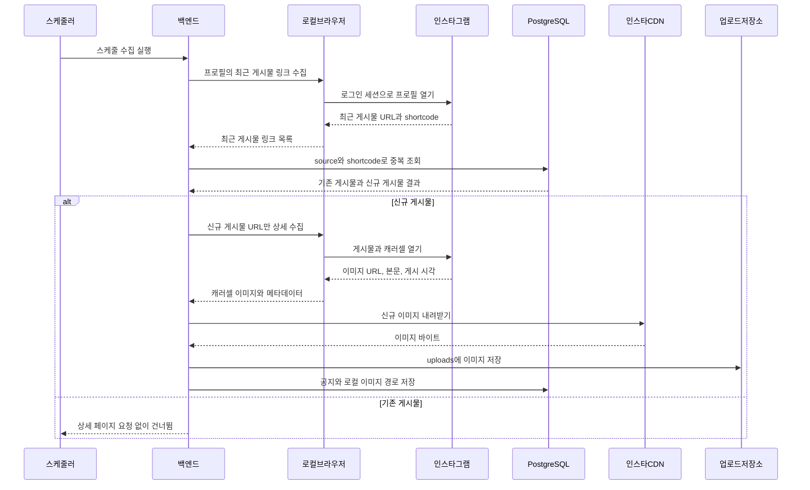

# Moa-Gwa BE

Spring Boot 3.2 / Java 21 / Maven / PostgreSQL (Flyway).

## Run
```bash
docker compose up -d          # local PostgreSQL (or: scripts/dev-db.sh start, no Docker needed)
./mvnw spring-boot:run        # http://localhost:8080/actuator/health
./mvnw test                   # tests use in-memory H2
```

## Push notifications (FCM)
Web push is sent by `notification/PushSender` after a notice is saved. It needs a Firebase **service-account key** (JSON).
- Keep the key **outside the repo**: `~/.secrets/moagwa-firebase-adminsdk.json` (never commit it).
- Run with `scripts/run-local.sh` — it picks the key up automatically. Or set `FIREBASE_CREDENTIALS_PATH=/path/to/key.json` yourself (production: mount the key as a secret file).
- Without a key the server still starts; push delivery is skipped and the log says `FCM push disabled`.
- Devices register through `PUT/DELETE /api/me/push-tokens` (table `device_tokens`).

## Google sign-in (Firebase)
Students can sign in with Google. The browser signs in through Firebase (popup) and sends the Firebase **ID token** to `POST /api/auth/google`; the server verifies it with the Firebase service-account key (same key as push) and issues our own JWT. Users are stored with `auth_provider = GOOGLE`.
- Needs the Firebase key (`FIREBASE_CREDENTIALS_PATH`, see above). Without it the endpoint answers `503`.
- Optional: `GOOGLE_ALLOWED_EMAIL_DOMAIN=school.ac.kr` limits sign-in to one email domain (empty = any Google account).
- Firebase console: Authentication → Sign-in method → Google must be enabled, and the site's domain must be in *Authorized domains* (`localhost` is there by default).

## Package layout (`com.moagwa`)
`common` · `notice` · `organization` · `user` · `admin` · `crawler` · `notification`

## Local login
With the `local` profile (default) sample data is created: admins `student-council`, `ai-council`, `cs-council` (password `moagwa1234`). Students sign in with `POST /api/auth/dev-student`; Kakao login needs `KAKAO_CLIENT_ID`.

## Crawler
Sources live in `crawl_sources` (seeded by `V2__seed_...sql`, 45 school sites). Runs every `crawler.interval` (default 10 min); disable with `CRAWLER_ENABLED=false`. The first crawl of a source backfills silently (no events).

## Instagram 크롤러 (로컬 Playwright, Apify 미사용)

인스타그램 학생회 공지는 백엔드 서버가 직접 수집한다. Apify Actor, Apify 토큰, 호출당 과금 API는 사용하지 않는다.

백엔드를 실행하는 모든 컴퓨터 또는 서버에는 아래 환경이 필요하다.

- Spring Boot용 Java 21
- Node.js 20 이상
- Playwright Chromium 브라우저
- 환경변수로만 주입하는 크롤러 전용 인스타그램 계정의 `sessionid` 쿠키
- 운영 환경에서 재배포 뒤에도 내려받은 이미지를 보존할 `uploads/` 영속 볼륨 또는 객체 스토리지

### 백엔드 실행 환경마다 한 번만 설정

```bash
cd BE/instagram-browser-scraper
npm ci
npx playwright install chromium
```

Linux 컨테이너 또는 VM은 브라우저 시스템 의존성도 함께 설치한다.

```bash
npx playwright install --with-deps chromium
```

로컬 개발에서는 무시되는 `BE/.env`에만 크롤러 계정 세션을 넣는다. 배포 환경에서는 배포 플랫폼의 Secret 환경변수로 주입한다. 세션 값은 절대 커밋하지 않는다.

```env
INSTAGRAM_SESSION_ID=replace-with-crawler-account-sessionid
INSTAGRAM_CRAWLER_ENABLED=false
```

세션과 브라우저 동작을 확인하기 전까지 크롤러는 비활성으로 둔다. 스케줄 수집을 켜려면 `INSTAGRAM_CRAWLER_ENABLED=true`로 변경한 뒤 백엔드를 재시작한다. 재시작 1분 뒤 첫 실행되며, 기본 주기는 하루다. 주기는 `INSTAGRAM_CRAWLER_INTERVAL`로 변경할 수 있다.

### 수집 순서

1. 로컬 헤드리스 Chromium이 등록된 각 프로필에서 최근 게시물 URL만 수집한다.
2. 백엔드가 게시물 shortcode를 DB와 대조해 중복 여부를 확인한다.
3. DB에 없는 신규 게시물만 로컬 Chromium으로 열어 캐러셀 이미지 URL과 게시물 정보를 추출한다.
4. 백엔드가 이미지를 `uploads/`에 내려받고, 공지와 로컬 이미지 경로를 PostgreSQL에 저장한다.

인스타그램 프로필 또는 게시물이 렌더링되지 않으면 수집에 실패하거나 해당 미저장 게시물을 건너뛴다. 이를 이미 수집한 게시물로 저장하지 않으므로 다음 스케줄에서 다시 시도할 수 있다.

### 시퀀스 다이어그램



Branching and commit rules: see [CONTRIBUTING.md](CONTRIBUTING.md).
