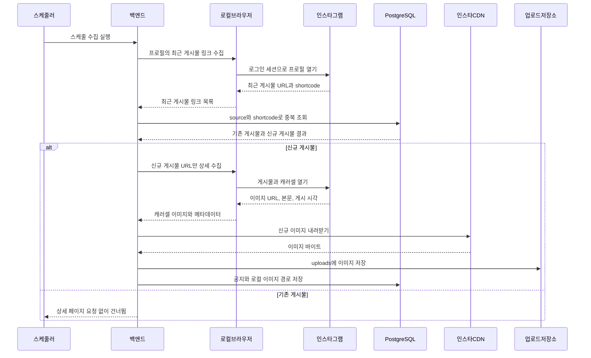

# 모아과 백엔드

가톨릭대학교 학내 공지와 일정을 통합 제공하는 Spring Boot API 서버.

## 주요 기능

- 학과·학생회별 공지 통합 조회
- 공지 검색, 상세 조회, 관심 기관 관리
- Google / Kakao 소셜 로그인
- 관리자 공지 등록·수정·삭제
- Firebase 웹 푸시 알림
- 학교 홈페이지 공지 크롤링
- Instagram 학생회 공지 및 캐러셀 이미지 수집

## 기술 스택

- Spring Boot 3.2
- Java 21
- Maven
- PostgreSQL
- Flyway
- Firebase Admin SDK
- Node.js + Playwright

## 실행

먼저 로컬 PostgreSQL을 실행.

```bash
docker compose up -d
# Docker를 사용하지 않는 경우
scripts/dev-db.sh start
./mvnw spring-boot:run
```

서버 주소: `http://localhost:8080`

헬스 체크:

```bash
curl http://localhost:8080/actuator/health
```

로컬 실행 시 Firebase 키가 있으면 `scripts/run-local.sh`가 자동으로 읽음.

```bash
scripts/run-local.sh
```

테스트는 인메모리 H2를 사용.

```bash
./mvnw test
```

## 환경변수와 보안

| 환경변수 | 용도 |
| --- | --- |
| `JWT_SECRET` | 자체 JWT 서명 키 |
| `FIREBASE_CREDENTIALS_PATH` | Firebase 서비스 계정 JSON 경로 |
| `KAKAO_CLIENT_ID` | 카카오 REST API 키 |
| `KAKAO_CLIENT_SECRET` | 카카오 선택적 보안 키 |
| `GOOGLE_ALLOWED_EMAIL_DOMAIN` | Google 로그인 허용 이메일 도메인 |
| `CORS_ALLOWED_ORIGINS` | 프론트엔드 허용 주소 |
| `DB_URL` | 운영 PostgreSQL 주소 |
| `DB_USERNAME` | 운영 DB 사용자 |
| `DB_PASSWORD` | 운영 DB 비밀번호 |

## 로그인과 알림

### Google 로그인

프론트엔드가 Firebase로 로그인한 뒤 ID Token을 `POST /api/auth/google`로 전달합니다. 백엔드는 Firebase 서비스 계정으로 토큰을 검증하고 자체 JWT를 발급.

- Firebase Console에서 Google 로그인 활성화
- 배포 도메인을 Authorized domains에 등록
- `FIREBASE_CREDENTIALS_PATH`가 없으면 Google 로그인은 사용할 수 없음
- `GOOGLE_ALLOWED_EMAIL_DOMAIN`을 비우면 모든 이메일 도메인 허용

### Kakao 로그인

프론트엔드가 Kakao OAuth 인가 코드를 `POST /api/auth/kakao`로 전달합니다. 백엔드는 Kakao 사용자 정보를 확인한 뒤 자체 JWT를 발급합니다.

### Firebase 푸시 알림

공지 저장 후 `notification/PushSender`가 웹 푸시를 전송합니다. Firebase 키가 없으면 서버는 정상 실행되지만 푸시만 비활성화됩니다.

푸시 토큰 API:

- `PUT /api/me/push-tokens`
- `DELETE /api/me/push-tokens`

## 주요 API

| 기능 | API |
| --- | --- |
| 관리자 로그인 | `POST /api/admin/auth/login` |
| Google 로그인 | `POST /api/auth/google` |
| Kakao 로그인 | `POST /api/auth/kakao` |
| 공지 피드 | `GET /api/feed` |
| 공지 상세 | `GET /api/notices/{id}` |
| 일정 조회 | `GET /api/schedule` |
| 실시간 공지 스트림 | `GET /api/stream` |
| 내 프로필 | `GET /api/me/profile` |

## 로컬 로그인

기본 `local` 프로필에서는 테스트용 관리자 계정이 생성.

- `student-council`
- `ai-council`
- `cs-council`
- 비밀번호: `moagwa1234`

학생 개발 로그인은 `POST /api/auth/dev-student`를 사용합니다. 운영 환경에서는 개발 로그인 기능을 사용하지 않음.

## 일반 공지 크롤러

일반 학교 홈페이지 공지는 `crawl_sources` 테이블에 등록된 출처에서 수집합니다. 기본 주기는 10분이며 `CRAWLER_ENABLED=false`로 비활성화할 수 있음

첫 수집은 기존 공지를 조용히 저장하고 알림 이벤트를 발송하지 않음.

## 패키지 구조

`com.moagwa` 아래에 다음 도메인이 있습니다.

- `common`: 공통 설정과 보안
- `auth`: Google·Kakao 인증
- `notice`: 공지 도메인
- `organization`: 학과·학생회
- `user`: 사용자와 관심 설정
- `admin`: 관리자 기능
- `crawler`: 일반·Instagram 크롤러
- `notification`: FCM 푸시

## Instagram 학생회 공지 크롤러 (로컬 Playwright)

인스타그램 학생회 공지는 백엔드 서버가 직접 수집한다. Apify Actor, Apify 토큰, 호출당 과금 API는 사용하지 않는다.

백엔드를 실행하는 모든 컴퓨터 또는 서버에는 아래 환경이 필요하다.

- Spring Boot용 Java 21
- Node.js 20 이상
- Playwright Chromium 브라우저
- 환경변수로만 주입하는 크롤러 전용 인스타그램 계정의 `sessionid` 쿠키
- 운영 환경에서 재배포 뒤에도 내려받은 이미지를 보존할 `uploads/` 영속 볼륨 또는 객체 스토리지

### 백엔드 실행 환경마다 한 번만 설정

```bash
cd instagram-browser-scraper
npm ci
npx playwright install chromium
```

Linux 컨테이너 또는 VM은 브라우저 시스템 의존성도 함께 설치한다.

```bash
npx playwright install --with-deps chromium
```

로컬 개발에서는 무시되는 `BE/.env`에만 크롤러 계정 세션을 넣는다. 배포 환경에서는 배포 플랫폼의 Secret 환경변수로 주입한다. 세션 값은 절대 커밋하지 않는다.

```env
INSTAGRAM_SESSION_ID=replace-with-crawler-account-sessionid
INSTAGRAM_CRAWLER_ENABLED=false
```

세션과 브라우저 동작을 확인하기 전까지 크롤러는 비활성으로 둔다. 스케줄 수집을 켜려면 `INSTAGRAM_CRAWLER_ENABLED=true`로 변경한 뒤 백엔드를 재시작한다. 재시작 1분 뒤 첫 실행되며, 기본 주기는 하루다. 주기는 `INSTAGRAM_CRAWLER_INTERVAL`로 변경할 수 있다.

### 수집 순서

1. 로컬 헤드리스 Chromium이 등록된 각 프로필에서 최근 게시물 URL만 수집한다.
2. 백엔드가 게시물 shortcode를 DB와 대조해 중복 여부를 확인한다.
3. DB에 없는 신규 게시물만 로컬 Chromium으로 열어 캐러셀 이미지 URL과 게시물 정보를 추출한다.
4. 백엔드가 이미지를 `uploads/`에 내려받고, 공지와 로컬 이미지 경로를 PostgreSQL에 저장한다.

인스타그램 프로필 또는 게시물이 렌더링되지 않으면 수집에 실패하거나 해당 미저장 게시물을 건너뛴다. 이를 이미 수집한 게시물로 저장하지 않으므로 다음 스케줄에서 다시 시도할 수 있다.

### 시퀀스 다이어그램



## 브랜치와 커밋

브랜치 전략과 커밋·PR 규칙은 [CONTRIBUTING.md](CONTRIBUTING.md)를 참고합니다.
